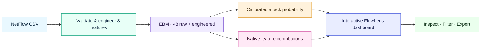

<div align="center">
  

  <br />

  <a href="https://github.com/Anandhasasidharan/FLOW-LENS/stargazers"></a>
  <a href="https://github.com/Anandhasasidharan/FLOW-LENS/commits/main"></a>
  
  

  <h3>See the signal. Understand the decision.</h3>
  <p>Explore network flows, detect attack-like traffic, and inspect the model's own feature-by-feature reasoning.</p>

  <a href="#get-started">Launch locally</a> · <a href="#benchmark-snapshot">Benchmark</a> · <a href="DEMO.md">Demo walkthrough</a> · <a href="docs/MODEL_CARD_V2.md">Model card</a>
</div>

<br />

## At a glance

| **1,419,227**<br/>training flows | **48 + 8**<br/>raw + engineered features | **354,814**<br/>chronological test flows | **Native**<br/>interpretable predictions |
|:---:|:---:|:---:|:---:|

FlowLens is an interactive network traffic analysis workspace powered by an **Explainable Boosting Machine (EBM)**. It combines a richer NetFlow model, native feature explanations, and a reproducible evaluation pipeline.

> **What the score means:** the model predicts benign versus attack. The dashboard's 0–10 risk index is estimated attack probability × 10; it does not estimate attack damage or severity.

## Explore FlowLens

- **See the traffic:** inspect attack-likelihood distributions, protocol and port activity, and filtered flows.
- **Inspect a prediction:** view the feature contributions that raise or lower the selected record's attack probability.
- **Understand model behavior:** explore native feature effects, importance, and handling of missing or unknown values.
- **Keep the evidence:** export predictions, filtered traffic, and evaluation results.

## Benchmark snapshot

### Chronological holdout · 354,814 flows · 31,107 attacks · 323,707 benign

| Model | Attacks detected | False positives | Benign false-positive rate |
|:--|--:|--:|--:|
| Nine-input LightGBM reference | 31,107 / 31,107 | 450 | 0.139015% |
| Rich-feature LightGBM reference | 31,107 / 31,107 | 4 | 0.001236% |
| **FlowLens EBM** | **31,107 / 31,107** | **2** | **0.000618%** |

**EBM precision: 99.9936%.** All nine attack families appeared in the final test, and all predeclared release checks passed. Both LightGBM references use the same full training partition, selected parameters, and eight derived features; their raw input profiles differ.

These measurements describe one laboratory dataset's chronological holdout. They do not establish performance on arbitrary networks. The dataset contains 37 Worms examples in the final test; per-family counts, calibration diagnostics, and scope are in the [model card](docs/MODEL_CARD_V2.md).

## How the explanation works

The EBM's learned feature effects add up to a decision score. For the deployed sigmoid-calibrated model, FlowLens transforms those terms so they reconstruct the **actual deployed probability**. The inspector checks this reconstruction against the classifier.

```text
calibrated log-odds = intercept + Σ(feature contributions)
attack probability  = sigmoid(calibrated log-odds)
```

The application shows signed contributions for an individual flow, global feature importance, and effect curves. Missing and unknown-category contributions are shown separately. These explain the fitted model; they do not imply causation. **V2 works without SHAP.**



## Get started

### 1 · Create an environment

Use **Python 3.11 or later** (the recorded training environment uses Python 3.12).

```bash
python -m venv .venv
```

Activate it with `source .venv/bin/activate` on Linux/macOS or `.venv\Scripts\Activate.ps1` in Windows PowerShell.

### 2 · Install and launch

```bash
python -m pip install -r requirements.txt
python -m streamlit run app/streamlit_visualizer.py
```

Open the local URL printed by Streamlit, usually `http://localhost:8501`. Choose **Load sample traffic** to explore ten development examples: benign traffic plus nine attack families. The trained model is included; you don't need the full dataset to run the app.

## Use your own traffic

Download the current sample from the app or start with [`data/rich_flow_sample.csv`](data/rich_flow_sample.csv), which contains the active model's 48-column input schema. Historical nine-field samples are not inputs to v2.

The measurements include ports, protocols, TCP flags, byte and packet counts, rates, packet sizes, retransmissions, TCP windows, DNS, FTP, ICMP, TTL, and inter-packet timing. Eight additional features are computed per row. Absolute timestamps, endpoint IPs, DNS transaction IDs, and labels are excluded from inference.

Upload UTF-8 CSV with headers, up to **50 MB / 100,000 rows**. Empty numeric measurements are supported. Invalid numeric text, infinite values, duplicate headers, and entirely empty records are rejected. No missing measurements are silently replaced with zero. See the [publisher's feature definitions](data/netflow_v3_features.csv).

Predictions include `Attack_Probability`, `Risk_Score`, `Predicted_Attack`, and `Risk_Category`. Display bands are Low (<3), Medium (3–<7), High (≥7); these are separate from the binary decision threshold. Extra fields are excluded from inference and retained for export.

## Reproduce the experiment

The source is [NF-UNSW-NB15-v3 from the University of Queensland](https://staff.itee.uq.edu.au/marius/NIDS_datasets/), with 2,365,424 flows and richer temporal and packet statistics. The original traffic is from **2015**; this is a richer extraction, not contemporary production traffic.

The experiment reserves chronological fitting, validation, calibration, and final-test partitions at 60/15/10/15 percent flow-start quantiles, purges flows crossing boundaries, screens parameters on development samples, then fits finalists on **all 1,419,227 eligible training records**. The final partition was evaluated after the model, probability policy, references, and thresholds were frozen.

```bash
python -m pip install -r requirements-training.txt
python scripts/fetch_rich_dataset.py
python scripts/prepare_rich_data.py
python scripts/train_interpretable_v2.py --output models/experiments/v2-reproduction
python scripts/freeze_reference_models_v2.py --experiment-dir models/experiments/v2-reproduction
python scripts/evaluate_interpretable_v2.py --experiment-dir models/experiments/v2-reproduction
```

Raw downloads and prepared data stay in ignored `data/raw/`. The [evaluation plan](models/v2/evaluation_plan.json), [development trials](models/v2/development_trials.json), [final evaluation](models/v2/final_evaluation.json), [feature audit](models/v2/feature_audit.json), and [dataset provenance](data/rich_dataset_provenance.json) document the experiment. Replaying the published split is a reproduction, not a new blind evaluation.

## Run the checks

```bash
python -m pip install -r requirements-dev.txt
python -m pytest -q
```

The software checks cover schema validation, artifact integrity, temporal separation, prediction parity, native explanation reconstruction without SHAP, uploads, exports, filters, and dashboard behavior. Software test results are separate from model benchmark performance.

## Project map

| Path | What's inside |
|:--|:--|
| `app/` | Interactive dashboard and native explanation views |
| `src/interpretable_detector.py` | Rich feature engineering and exact EBM explanations |
| `scripts/` | Download, preparation, training, freezing, and evaluation |
| `models/v2/` | Active model and evaluation evidence |
| `data/` | Feature definitions, sample traffic, and source provenance |
| `notebooks/` | Exploration and model inspection |
| `docs/` | Model cards, research review, and archived history |

## More

[Demo walkthrough](DEMO.md) · [Model card](docs/MODEL_CARD_V2.md) · [2026 interpretability review](docs/EXPLAINABILITY_RESEARCH_2026.md) · [Operational next steps](PRODUCTION_READY_GUIDE.md) · [Archived v1 README](docs/history/README_V1.md)

### Dataset attribution

Follow the [publisher's dataset page](https://staff.itee.uq.edu.au/marius/NIDS_datasets/) and [v3 temporal-analysis paper](https://arxiv.org/abs/2503.04404) for citations. Academic research reuse includes a commercial-use restriction requiring agreement with the authors. Dataset terms do not constitute a software license for this repository.
