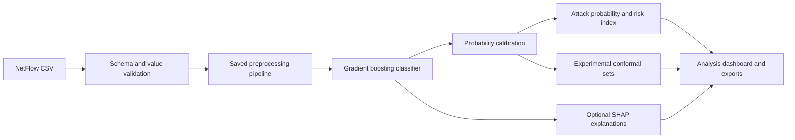

> Historical v1 documentation. See the [active FlowLens README](../../README.md) for the v2 model.

# FlowLens

### Explainable Network Intrusion Analysis

Explore network traffic, estimate attack likelihood, and inspect the evidence behind model predictions.

FlowLens is a Python and Streamlit research prototype built around a reproducibly trained NetFlow attack detector. It combines an interactive analysis workspace with model comparisons, optional SHAP explanations, experimental uncertainty estimates, and downloadable evaluation evidence.

**Stack:** Python 3.11+ · Streamlit · scikit-learn · pandas · NumPy · Matplotlib · optional SHAP

**Status:** Working research prototype · 49 automated tests passed · further independent model validation required

[Try the demo](#quick-start) · [Model results](#measured-results) · [Model card](../../docs/MODEL_CARD.md) · [Research review](../../docs/EXPLAINABILITY_RESEARCH_2026.md) · [Presentation walkthrough](../../DEMO.md)

## The project

An intrusion detector should be understandable and testable as well as useful to explore. FlowLens turns a CSV of network flows into a workspace where users can review estimated attack likelihood, filter suspicious records, inspect individual inputs, and examine the model's measured strengths and weaknesses.

The classifier predicts the dataset publisher's **binary attack label**. Its displayed **risk index = estimated attack probability × 10**. This index measures estimated likelihood, not the severity or impact of an attack.

The project includes a preserved failed experiment: an initial model performed strongly in-domain but detected only **7.87%** of attacks on another dataset. That result motivated training across both sources and reporting source-specific performance alongside aggregate scores.

## Features

- **One-click demo:** Analyze eight real feature-only holdout records without downloading the full datasets.
- **Traffic overview:** Review risk distributions, protocol summaries, destination-port activity, and highest-scoring flows.
- **Interactive exploration:** Combine protocol, risk-band, and risk-index filters; retain original row references in filtered exports.
- **Record inspection:** Inspect model inputs, attack probability, binary decisions, and experimental prediction sets.
- **Model explanations:** Optional SHAP plots explain the base estimator; permutation importance summarizes raw-feature sensitivity.
- **Evaluation evidence:** Compare candidate models, probability policies, source-specific and per-attack results, calibration, and uncertainty diagnostics.
- **Validated inputs and exports:** Enforce CSV limits and numeric constraints; download predictions, filtered records, analysis summaries, and the training report.

## Quick start

Use **Python 3.11 or later**. Training was performed with Python 3.12; the saved model requires the pinned scikit-learn version in `requirements.txt`.

From the project directory:

```bash
python -m venv .venv
```

Activate the environment:

```bash
# Linux / macOS
source .venv/bin/activate
```

```powershell
# Windows PowerShell
.venv\Scripts\Activate.ps1
```

Install dependencies and launch:

```bash
python -m pip install -r requirements.txt
python -m streamlit run app/streamlit_visualizer.py
```

Open the URL printed by Streamlit, normally `http://localhost:8501`, and select **Load sample traffic**.

The trained model and sample CSV are included. The full datasets are needed only to reproduce training. Launch from the repository root to use the configured dark theme. Restart Streamlit after retraining to reload the cached model and evaluation report.

### Optional SHAP explanations

```bash
python -m pip install -r requirements-shap.txt
```

Enable batch SHAP in the sidebar or select **Explain selected record** in the inspector. SHAP explains the base estimator before probability calibration; its contribution units differ from the displayed 0–10 risk index. Predictions remain available when the optional explanation dependencies are absent.

## Measured results

The active model is **histogram gradient boosting with sigmoid probability calibration**, selected through validation comparisons against a prior-only baseline, logistic regression, and Extra Trees. Raw, sigmoid, and isotonic probability policies were compared.

| Experiment detail | Value |
| --- | --- |
| Dataset sources | NF-ToN-IoT v1 + NF-BoT-IoT v1 |
| Total source records | 1,979,374 |
| Records used for fitting | 250,000 |
| Model inputs | 9 NetFlow fields |
| Held-out test records | 541,272 |
| Evaluation grouping | Dataset source and unordered IPv4 host pair |

| Aggregate test metric | Measured result |
| --- | ---: |
| Attack recall | 99.95% |
| Precision | 99.67% |
| F1 score | 0.9981 |
| Average precision | 0.99991 |
| Benign false-positive rate | 1.76% |

**These aggregate results have important limits:**

- NF-BoT-IoT's held-out benign false-positive rate was **32.56%**, despite the much lower aggregate rate.
- NF-ToN-IoT backdoor recall was **20%** on 60 test records; MITM recall was **82.28%** on 79 records.
- Theft and ransomware had no test support; some other attack samples were too small for robust conclusions.
- The host-pair test partition was inspected across pipeline revisions. Results are exploratory and require confirmation on a fresh locked source or capture.
- Host-pair separation permits individual hosts to appear in multiple partitions. It does not establish unseen-host, temporal, or production-network generalization.

The model **does not meet all benchmark quality targets**. It remains a research prototype. See the [model card](../../docs/MODEL_CARD.md) and [machine-readable training report](../../models/training_report.json) for confusion matrices, per-source and per-family results, descriptive group-bootstrap intervals, and the full limitations.

## How it works



The saved artifact contains the fitted preprocessing pipeline, classifier, selected probability policy, binary decision threshold, and conformal calibration value. The app verifies its SHA-256 checksum against the evaluation report before loading it.

**Display bands** are Low (<3), Medium (3–<7), and High (≥7). They are presentation conventions, separate from the binary threshold selected on validation data.

**Experimental conformal sets** indicate plausible labels under the fitted calibration procedure. Empty or multi-label sets call for review. Measured coverage is disclosed in the model card; dependence and distribution shift prevent a blanket coverage guarantee.

## Input format

Use [data/netflow_sample.csv](../../data/netflow_sample.csv) or download the sample in the app. The legacy `data/sample_input.csv` uses a different schema and is not compatible with the active detector.

| Required field | Meaning |
| --- | --- |
| `L4_DST_PORT` | Destination transport port |
| `PROTOCOL` | Numeric IP protocol identifier |
| `L7_PROTO` | Numeric Layer 7 protocol identifier |
| `IN_BYTES` / `OUT_BYTES` | Incoming / outgoing byte counts |
| `IN_PKTS` / `OUT_PKTS` | Incoming / outgoing packet counts |
| `TCP_FLAGS` | Cumulative TCP flags |
| `FLOW_DURATION_MILLISECONDS` | Flow duration in milliseconds |

See the publisher's [NetFlow feature definitions](../../data/netflow_v1_features.csv).

Uploads must be UTF-8 CSVs with headers, at most **50 MB and 100,000 rows**. Required values must be finite, nonnegative, and complete. Ports, IP protocol identifiers, flags, byte counts, and packet counts must be whole numbers; Layer 7 identifiers may be decimal-valued. Duplicate headers and invalid measurements are rejected.

Labels, attack categories, endpoint addresses, source ports, and other extra fields are retained for export but excluded from model inputs. The dashboard derives presentation fields for protocol, destination port, flags, duration, bytes, and packets; port values do not prove an application protocol. Model outputs and derived display fields replace uploaded columns with the same names.

Exports include `Attack_Probability`, `Risk_Score`, `Predicted_Attack`, `Risk_Category`, and `Prediction_Set`. Formula-like text is escaped for safer spreadsheet opening. Explorer filters affect the traffic table and filtered download; overview statistics describe the full batch.

## Reproduce the experiment

Download the two datasets directly from the University of Queensland's public delivery service:

```bash
python scripts/fetch_dataset.py
python scripts/fetch_dataset.py --dataset nf-bot-iot
python scripts/train_detector.py --include-bot
python scripts/write_model_card.py
```

Raw files remain in ignored `data/raw/`. Source URLs, reuse terms, and checksums are recorded in [dataset provenance](../../data/dataset_provenance.json) and [the second source's provenance](../../data/external_dataset_provenance.json).

The training workflow:

1. Groups flows by dataset source and unordered host pair.
2. Reserves separate fitting, validation, probability-calibration, conformal-calibration, and test partitions.
3. Deduplicates fitting records only, retaining ambiguous and repeated patterns in holdouts.
4. Compares four classifiers and three probability policies, with fitting capped at 250,000 records.
5. Selects validation attack recall subject to a benign false-positive target of 5% for each represented source; uses average precision and Brier score as tie-breakers.
6. Records evaluation metrics, rare-attack gaps, source-specific failures, novelty diagnostics, permutation importance, versions, timings, and quality checks.

Natural identical feature values can occur in different host pairs. A separate diagnostic evaluates test patterns absent from all development partitions. Bootstrap intervals are descriptive and omit model-fitting variability.

The earlier single-source external failure is retained in [its evaluation report](../../reports/initial_external_evaluation.json) and `models/experiments/nf_ton_iot/`. Both sources now participate in development; they cannot serve as independent external validation for the current model.

## Explainability research

The [research review](../../docs/EXPLAINABILITY_RESEARCH_2026.md), checked on **12 November 2026**, links original papers and maintainer documentation covering:

- Constrained counterfactual explanations using DiCE.
- Transformer-based counterfactual generation with TABCF.
- Joint classification and counterfactual explanations with HyConEx.
- Intrinsically interpretable Explainable Boosting Machines.
- Conformal prediction and explanations for prediction sets.
- Tabular foundation models such as TabPFN as predictive benchmarks.

The implemented tools are optional SHAP, permutation importance, probability-policy comparisons, and experimental conformal prediction sets. DiCE, TABCF, HyConEx, EBM, and TabPFN are researched extensions, not implemented or validated features. Explanations alone do not establish detection efficacy or causality.

## Tests

```bash
python -m pip install -r requirements-dev.txt
python -m pytest -q
```

**49 tests passed** in the recorded development environment. Coverage includes input limits and validation, artifact/report integrity, prediction parity, label exclusion, batch invariance, group separation, threshold selection, prediction-set membership, exports, demo lifecycle, filters, uploads, and missing-SHAP behavior.

Successful SHAP plotting requires the optional dependencies and has not been verified in this workspace. Browser appearance has not been visually verified. Passing software tests does not certify model accuracy.

## Repository structure

```text
app/                    Streamlit analysis workspace
src/                    Validation, inference, dashboard analysis, and legacy helpers
scripts/                Dataset download, training, evaluation, and model-card generation
models/                 Active detector, training evidence, and archived experiments
data/                   Demo inputs, feature definitions, and provenance
notebooks/              Dataset exploration and reproducible model evidence
reports/                Legacy artifact audit and historical external evaluation
tests/                  Inference, model, and dashboard checks
docs/                   Model card and explainability research
.streamlit/             Theme and upload configuration
```

## Next milestones

- Reduce source-specific benign false alerts and improve weak attack-category recall.
- Validate on a fresh external dataset or future capture with compatible feature extraction.
- Evaluate temporal and device-disjoint splits, realistic attack prevalence, and drift.
- Compare richer flow features and constrained counterfactual explanations.
- Add deployment authentication, resource controls, dependency locking, and CI.

See [DEMO.md](../../DEMO.md) for a presentation walkthrough and [the validation and deployment guide](../../PRODUCTION_READY_GUIDE.md) for remaining engineering work.

## Dataset attribution and reuse

Datasets were obtained from the [University of Queensland's NetFlow dataset collection](https://staff.itee.uq.edu.au/marius/NIDS_datasets/). Cite:

> Sarhan, M., Layeghy, S., Moustafa, N., and Portmann, M. (2021). *NetFlow Datasets for Machine Learning-Based Network Intrusion Detection Systems.* Big Data Technologies and Applications.

The dataset publisher permits academic research reuse with attribution; commercial reuse requires agreement with the authors. These dataset terms do not constitute a software license for this repository.
